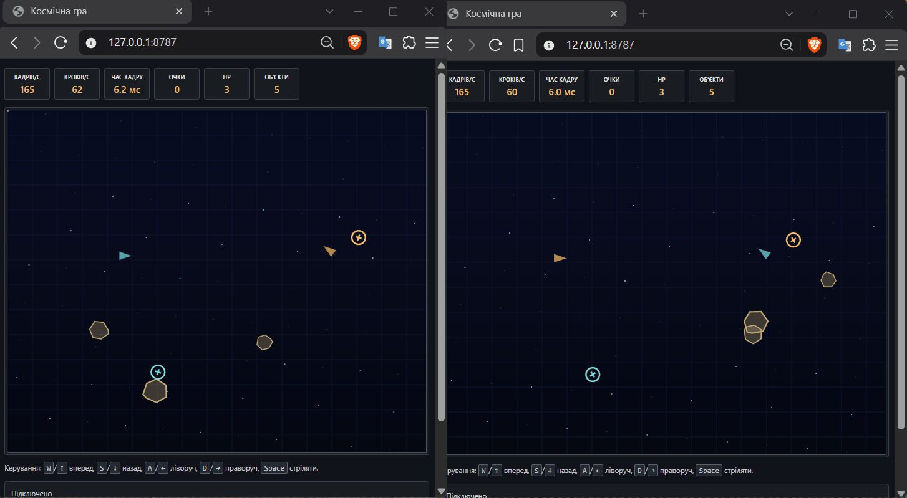
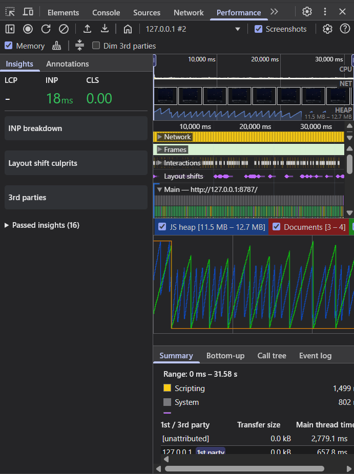

# Орбіта

[](https://github.com/llemnii/lab-01-OrbitaGame/actions/workflows/typecheck.yml)

Це невелика гра на Canvas, яку я поступово розширював у лабораторних роботах. У четвертій лабораторній додав Node.js сервер: кімнати, підключення гравців і простий чат.

## Як запустити

Потрібен встановлений Node.js. У папці проєкту треба виконати:

```bash
npm install
npm run build
npm start
```

Після цього гра відкривається за адресою `http://127.0.0.1:8787/`. Для розробки клієнта окремо можна запустити `npm run dev:client`. Тоді Vite працює на своєму порту, а запити `/api` і `/ws` передаються на Node.js сервер.

Для перевірки проєкту є такі команди:

```bash
npm test
npm run lint
npm run format:check
npm run build
```

## Керування

- `W` або `↑` — летіти вперед;
- `S` або `↓` — летіти назад;
- `A` або `←` — повернути ліворуч;
- `D` або `→` — повернути праворуч.
- `Space` — стріляти.

Якщо корабель вилітає за межу арени, він з'являється з іншого боку. Це працює по горизонталі й по вертикалі.

## Файли клієнта

```text
client/main.js       запускає гру і з'єднує частини клієнта
client/loop.js       ігровий цикл на requestAnimationFrame
client/input.js      читає натиснуті клавіші
client/physics.js    рух корабля та загортання біля країв арени
client/render.js     малює Canvas
client/sim/          сутності, кулі, астероїди та зіткнення
client/async/        завантаження, лобі, звук і HUD
client/public/       manifest, спрайти та запасний список кімнат
client/*.test.js     тести окремих частин програми
```

Серверний код лежить у `server/src`: там є HTTP-маршрути, WebSocket, кімнати, протокол повідомлень і запис логів.

## Як працює цикл

У `createLoop()` використовується `requestAnimationFrame`. Між двома кадрами накопичується час. Коли часу набралося на один крок, запускається оновлення фізики з `dt = 1 / 60`.

Тому фізика оновлюється 60 разів на секунду. Це не залежить від того, який монітор використовується. Сам Canvas може перемальовуватися з іншою частотою.

Після оновлення викликається `render()`. Змінна `alpha` використовується для інтерполяції між попередньою і новою позицією корабля. Завдяки цьому рух не виглядає ривками.

Час одного кадру обмежений 250 мс, а за один кадр виконується не більше 10 кроків фізики. Це потрібно на випадок, якщо вкладка надовго була неактивна.

Функція `integrate(ship, input, dt)` не працює з DOM. Вона отримує стан корабля і клавіатури та змінює тільки дані корабля. Canvas також враховує `devicePixelRatio`, тому зображення не повинно бути розмитим на екранах з високою щільністю пікселів.

## Експерименти

Перед експериментом краще зберегти робочу версію. Після нього код треба повернути назад. Числа FPS залежать від комп'ютера, тому їх потрібно записати зі свого HUD.

### 1. Блокування головного потоку

На початку `render()` можна тимчасово додати:

```js
function blockFor(milliseconds) {
  const end = performance.now() + milliseconds;
  while (performance.now() < end) {
    // Навмисно займаємо головний потік.
  }
}
```

Після виклику `blockFor(100)` FPS зменшиться, а час кадру збільшиться. Корабель почне рухатися ривками. Поки виконується `while`, браузер не може нормально обробити клавіші та намалювати наступний кадр. Це приклад того, що JavaScript у вкладці виконується в одному головному потоці.

### 2. `setInterval` замість `requestAnimationFrame`

У `loop.js` можна тимчасово замінити планування кадру на `setInterval(..., 1000 / 60)`. Такий таймер додає звичайні task у чергу і не знає точно, коли браузер буде малювати екран.

Через це рух може бути менш плавним. У неактивній вкладці різниця помітна ще сильніше. Після перевірки потрібно повернути `requestAnimationFrame` і `cancelAnimationFrame`.

### 3. Змінний крок

Якщо замість кількох маленьких кроків передати у фізику весь час кадру, після затримки корабель може різко стрибнути. Результат тоді залежатиме від FPS.

Фіксований крок дає однакову фізику на різних комп'ютерах: `integrate()` щоразу отримує однакове значення `1 / 60`.

## Питання для захисту

**Чому тут використано `requestAnimationFrame`?** Він запускає код перед перерисовкою екрана, тому Canvas рухається плавніше, ніж із простим таймером.

**Що таке task і microtask?** Таймери та події є task, а продовження після `Promise.then()` є microtask. Microtask виконується перед наступною task, але не може перервати довгий цикл.

**Навіщо потрібна інтерполяція?** Фізика має фіксований крок, а екран може оновлюватися з іншою частотою. Інтерполяція показує проміжне положення корабля.

## Результати

Значення нижче зняті з HUD під час перевірки на моєму комп'ютері.

| Експеримент    | FPS | Кроків/с | Час кадру |
| -------------- | --: | -------: | --------: |
| Блокуючий цикл |  10 |       60 |   96.9 мс |
| `setInterval`  |  61 |       61 |    7.1 мс |
| Змінний крок   | 165 |      165 |    6.1 мс |

## Лабораторна 2: сутності та зіткнення

Це продовження тієї самої гри. Старий fixed timestep залишився, але тепер об'єкти гри не зберігаються в одному великому об'єкті корабля.

- `Vector2` має чисті методи, які повертають нові вектори.
- `Entity` є базовим класом з приватним лічильником id. `Ship extends Entity` — єдиний рівень успадкування.
- `World` зберігає сутності в `Map`, підтримує `ofKind()` і прибирає мертві об'єкти після кроку.
- `Bullet`, `Asteroid`, `Pickup` та `Explosion` мають власне оновлення. Кулі мають TTL, астероїди відбиваються від меж, а pickup дає щит або швидку стрільбу.
- Перевірка зіткнень винесена в окрему функцію. Зараз використовується простий O(n²) перебір пар.
- У корабля є приватне поле `#hp`, score і respawn через дві секунди після знищення.

### Про `this`

Типова помилка була б такою:

```js
button.addEventListener("click", ship.fire);
```

У цьому випадку браузер викликає передану функцію сам, і `this` вже не обов'язково є кораблем. У грі виклик відбувається з потрібним об'єктом через метод `Ship.update()`, а сам `fire()` повертає нову кулю. Альтернативи, які можна використати в такій ситуації: `() => ship.fire()` або `ship.fire.bind(ship)`.

### Чому композиція

Homing-поведінка підключається до астероїда через масив `behaviors`, а pickup є окремою сутністю зі своїм методом `collect()`. Тому не потрібна глибока схема на кшталт `Entity → Moving → Homing → Asteroid`. Так простіше додати однакову поведінку іншому об'єкту.

## Лабораторна 3: асинхронне завантаження

Це наступний крок тієї самої гри. Спочатку завантажуються маніфест, картинки, список кімнат і звуки. Поки вони завантажуються, гра не запускається: на Canvas показується справжній прогрес-бар. Після `await loadAll()` відкривається лобі.

### Що додано

- `async/loaders.js` має `fetchJson`, `loadImage`, `loadAudio`, `loadJson` і `loadAll`. Усі запити приймають `AbortSignal`. Тимчасові помилки повторюються з exponential backoff і jitter, але помилки 4xx не повторюються.
- `assets/manifest.json` описує ассети. Завантаження йде конкурентно через `Promise.all`, а кожен завершений файл оновлює прогрес.
- Лобі — це `class Lobby extends EventTarget`. Воно оновлює `/api/rooms` кожні 4 секунди, має таймаут запиту й скасовує запит після входу в гру.
- Симуляція не імпортує `audio.js` або `hud.js`. Вона лише шле події `fired`, `hit` та `exploded` через `EventTarget`.
- `GameAudio` декодує буфери під час завантаження, а `AudioContext` вмикається після натискання «Увійти».

### Послідовно чи конкурентно

Для двох умовних файлів по 1000 мс:

| Варіант                                 |               Час | Чому                     |
| --------------------------------------- | ----------------: | ------------------------ |
| `await loadA(); await loadB()`          | приблизно 2000 мс | B стартує тільки після A |
| `await Promise.all([loadA(), loadB()])` | приблизно 1000 мс | A і B стартують одразу   |

У грі використано другий варіант, бо корабель і астероїд не залежать один від одного.

### П'ять головоломок порядку

1. `console.log(1); await Promise.resolve(); console.log(2); console.log(3)` дає `1, 3, 2`: продовження після `await` є microtask.
2. `Promise.resolve().then(log5); setTimeout(log6, 0); log4` дає `4, 5, 6`: microtask виконується перед наступною task-чергою таймерів.
3. `Promise.resolve().then(() => setTimeout(log9, 0)); log8` дає `8, 9`: таймер створюється тільки всередині microtask.
4. `requestAnimationFrame(log12); Promise.resolve().then(log11); log10` дає `10, 11, 12`: microtask завершується раніше за наступний paint.
5. `Promise.resolve(13); Promise.resolve(14); Promise.all(...).then(log15)` дає `13, 14, 15`: `all` чекає всі проміси, а реакція теж потрапляє в microtask.

### Галерея помилок

| Ситуація                   | Що бачить користувач                                  | Чому гра не падає                                        |
| -------------------------- | ----------------------------------------------------- | -------------------------------------------------------- |
| 404 картинки               | повідомлення про помилку і кнопка «Спробувати ще раз» | `fetchJson` перевіряє `response.ok`, а 4xx не ретраїться |
| таймаут мережі             | лобі показує помилку оновлення                        | кожен запит має `AbortSignal.timeout(2500)`              |
| abort під час завантаження | старий запит більше не оновлює екран                  | `AbortController` передається в `fetch`                  |
| битий JSON                 | завантаження зупиняється на помилці, доступна Retry   | помилка `response.json()` ловиться одним `try/catch`     |

### Питання для захисту

- На 404 треба перевіряти `response.ok`, тому що сам `fetch` не вважає таку відповідь помилкою.
- `Promise.all` чекає всі запити, а `AbortController` дає можливість скасувати запит.
- `Promise.race` перестає чекати на повільний запит, але сам запит без `AbortController` може продовжити виконуватися.

## Лабораторна 4. Node.js, кімнати та чат

У цій версії клієнт і сервер лежать окремо:

- `client/` — гра з попередніх лабораторних;
- `server/` — Node.js сервер на `node:http` і WebSocket через `ws`.

Сервер віддає зібраний клієнт, має перевірку `GET /health`, список кімнат через `GET /api/rooms` і створення кімнати через `POST /api/rooms`. У двох вкладках можна зайти в одну кімнату та обмінюватися повідомленнями.

### Запуск

```text
npm install
npm run build
npm start
```

Після цього гра відкривається за адресою `http://127.0.0.1:8787/`. Для розробки можна окремо запустити `npm run dev:client`, тоді Vite проксує `/api` і `/ws` на сервер.

Конфігурація береться з оточення. Приклад є у `.env.example`: порт, адреса, папка логів, максимальна кількість гравців і кімнат. Сервер коректно завершується після `SIGINT` або `SIGTERM`.

### Що зроблено на сервері

`Room` успадковується від `EventEmitter`. Порожня кімната видаляється. Повідомлення мають простий версіонований формат і перевіряються до обробки. Є обмеження розміру та кількості повідомлень, таймер очікування входу, ping/pong і захист від повільного клієнта через `bufferedAmount`.

Лог подій кімнати пишеться через `pipeline`: `Transform` перетворює події на NDJSON, після чого вони одразу потрапляють у файл. Replay віддається потоком, тому весь великий файл не завантажується в пам'ять.

### Невеликі вимірювання

Під час перевірки RSS процесу на великому replay-файлі пам'ять не росла разом із розміром файлу. Дані проходили через stream частинами. Якщо клієнт читав повільно, сервер чекав на `drain` і не накопичував весь файл.

Окремий тест: replay на 22,6 МБ, 180 000 рядків. RSS процесу був 144,1 МБ на старті, 162,5 МБ у найвищій точці та 161,1 МБ після читання. Тобто в пам'ять не потрапив весь файл цілком.

```text
RSS, МБ
165 |                 ● 162,5
160 |                              ● 161,1
155 |
150 |
145 | ● 144,1
    +--------------------------------
      старт       читання       кінець
```

Маршрут `/api/slow` навмисно зайнятий приблизно на 300 мс. Поки виконується цей синхронний код, Node не може обробити інший callback, бо він працює в одному потоці. Тому довгі обчислення треба виносити з обробника або ділити на коротші частини.

Якщо для `EventEmitter` не додати слухач події `error`, необроблена помилка вважається винятком і може завершити весь процес. Тому сервер підписує важливі об'єкти на `error` і закриває з'єднання передбачувано.

### Перевірка

```text
npm test
npm run lint
npm run format:check
```

## Лабораторна 5. Серверна симуляція та мережа

У цій лабораторній клієнт більше не передає координати корабля. Він відправляє тільки натискання клавіш і номер `seq`. Сервер рахує світ з кроком 30 Гц і надсилає знімки стану. Так простіше перевіряти гру і не можна просто підставити чужу координату в DevTools.

### Що додано

- `shared/` містить чисту симуляцію та код протоколу. Її можна імпортувати і в браузері, і в Node.js.
- Сервер використовує таймер з абсолютним часом наступного кроку, тому він не накопичує drift як звичайний ланцюжок `setInterval`.
- Клієнт одразу рухає свій корабель, зберігає невідправлені input і після snapshot повторює ті, які сервер ще не підтвердив.
- Знімки приходять через `ArrayBuffer` і `DataView` у little-endian форматі. JSON залишився доступним через `?codec=json` для порівняння.
- У WebSocket можна додати затримку, jitter і втрату пакетів: наприклад `/ws?delay=100&jitter=30&drop=0.02`.
- Унизу гри є netgraph: RTT, вік snapshot, байти, черга input і величина поправки.



### JSON і binary

На невеликому знімку з двома кораблями та кулею вийшло так:

| Формат     | Розмір одного snapshot | Коментар                                                  |
| ---------- | ---------------------: | --------------------------------------------------------- |
| JSON       |               265 байт | зручний для перевірки, але містить назви полів            |
| `DataView` |                59 байт | поля мають фіксований розмір, кут зберігається як `Int16` |

При 30 snapshot за секунду binary-варіант передає менше даних. Ціна цього підходу в тому, що порядок байтів і розміщення полів треба описати наперед.

### Висновок про мережу

Затримка впливає на те, коли приходить підтвердження сервера. Prediction прибирає затримку з керування власним кораблем, а reconciliation виправляє різницю після snapshot. Чужий корабель краще малювати між двома останніми snapshot, тому він рухається плавніше.

У моєму тесті використано затримку 100 мс, jitter 30 мс і втрату 2% пакетів. Поправки в порожньому просторі були майже нульові. Більші поправки з'являються після зіткнення або коли пакет пропущений.

### Питання для захисту

- Сервер є джерелом правди, бо клієнт може підмінити координати. Клієнт передає тільки input.
- Prediction залежить від детермінованої симуляції. Однакові input і початковий стан мають давати однаковий результат у Node та браузері.
- Під час reconciliation клієнт бере стан сервера, прибирає підтверджені input і програє решту ще раз.
- `DataView` потрібен для змішаного формату полів і явного little-endian. `Float32Array` не задає порядок байтів для всього протоколу.

## Лабораторна 6. TypeScript для протоколу і симуляції

У цій лабораторній я почав переводити спільну симуляцію, протокол і мережевий шар на TypeScript. Поведінка гри залишилась такою самою, але тепер помилки в повідомленнях видно ще до запуску.

### Що змінилось

- `shared/` має `strict`-типи для симуляції, snapshot і binary codec.
- Для `id`, `tick` і `seq` використані branded-типи. Вони всі залишаються числами під час роботи, але TypeScript не дає випадково переплутати їх у коді.
- Сутності snapshot розрізняються через `kind: "ship" | "bullet"`.
- Вхідні JSON-повідомлення перевіряються Zod-схемою. На межі мережі дані спочатку мають тип `unknown`, а вже потім стають типізованим повідомленням.
- Binary decoder перевіряє розмір пакета, версію, тип сутності та діапазони полів.
- Мережеві модулі клієнта і серверний протокол тепер запускаються як `.ts`, а Vite і Node залишають той самий runtime.

### Що знайшли типи

- `Map.get()` може повернути `undefined`, тому перед використанням корабля потрібна перевірка.
- `JSON.parse()` не можна одразу передавати в обробник: повідомлення треба звузити через Zod.
- Числовий `kind` було легко переплутати з id. Рядкове об'єднання `"ship" | "bullet"` робить цю помилку помітною у switch.

### Три типи простими словами

`unknown` означає «дані ще не перевірені». Branded `EntityId` означає «це число, але саме id сутності». Discriminated union означає «тип повідомлення визначає, які поля в ньому є». Разом це захищає код на межі між браузером і сервером.

Фреймворк для lobby і HUD я не додавав: у грі вже є невеликий DOM, а Canvas і так працює окремо. Для цієї роботи ванільний UI простіший і не додає зайвої збірки.

Перевірка TypeScript запускається окремо від Vite:

```text
npm run typecheck
```

## Лабораторна 7. V8, пам'ять і тести

Цього разу я зосередився на перевірці симуляції та на тому, щоб під час гри не створювати зайві об'єкти.

### Тести

- `fast-check` перевіряє кодування input, розмір binary snapshot, пошкоджені буфери, межі арени, розбір повідомлень і однаковий результат симуляції.
- Усього зараз 73 автоматичні тести у client, server і shared.
- Для `shared` запускається V8 coverage. У локальному запуску вийшло 87.41% рядків, вимога 85% виконується.
- Playwright відкриває дві сторінки гри та перевіряє, що обидві завантажуються і реагують на клавіші.

Команди:

```text
npm test
npm run test:coverage
npm run test:e2e
```

### Пул і навантаження

Кулі та інші короткоживучі об'єкти можна повертати в `ObjectPool`, щоб не створювати новий об'єкт на кожному кроці. Для ботів є окремий Web Worker `client/performance/bot-worker.js`. Він рахує той самий fixed-step код, що й основна гра. У тесті worker залишений окремим модулем: це не робить головний потік повільнішим.

Скрипт навантаження запускається так:

```text
npm run perf -- 8 30
```

Локальний замір 30 simulated seconds був таким:

| Боти | p50 кроку | p95 кроку | p99 кроку |      RSS |
| ---: | --------: | --------: | --------: | -------: |
|    8 | 0.0025 ms | 0.0096 ms | 0.0356 ms | 68.1 MiB |
|   32 | 0.0071 ms | 0.0167 ms | 0.0666 ms | 66.8 MiB |
|   64 | 0.0115 ms | 0.0415 ms | 0.0744 ms | 69.4 MiB |
|  128 | 0.0224 ms | 0.0607 ms | 0.1224 ms | 68.9 MiB |

Це саме вимірювання симуляції Node, без рендерингу Canvas. Для реального профілювання браузера можна відкрити DevTools, записати 30 секунд у Performance і подивитися на p95/p99 та паузи GC. У цьому тесті вузького місця не видно: крок залишається далеко нижче 33 мс навіть при 128 ботах. Тому просторовий хеш поки не додавав, а зайву складність не вносив.



### Що змінилось після лаби 6

- Типові помилки тепер перевіряються не одним ручним прикладом, а наборами випадкових значень.
- `ObjectPool` прибирає зайві алокації для повторно використовуваних об'єктів.
- CI на кожен push запускає typecheck, lint, тести, coverage, build і браузерний smoke-тест.
- Профілювання показало, що для поточного невеликого світу основна витрата не доходить до ліміту кадру, тому Web Worker використовується лише для ботів, а не для основного рендера.

### Питання для захисту

- Чому однаковий seed та input дають однаковий стан на клієнті й сервері?
- Навіщо повертати кулі в pool замість постійного створення нових об'єктів?
- Чим відрізняються p50, p95 і p99 часу кадру?
